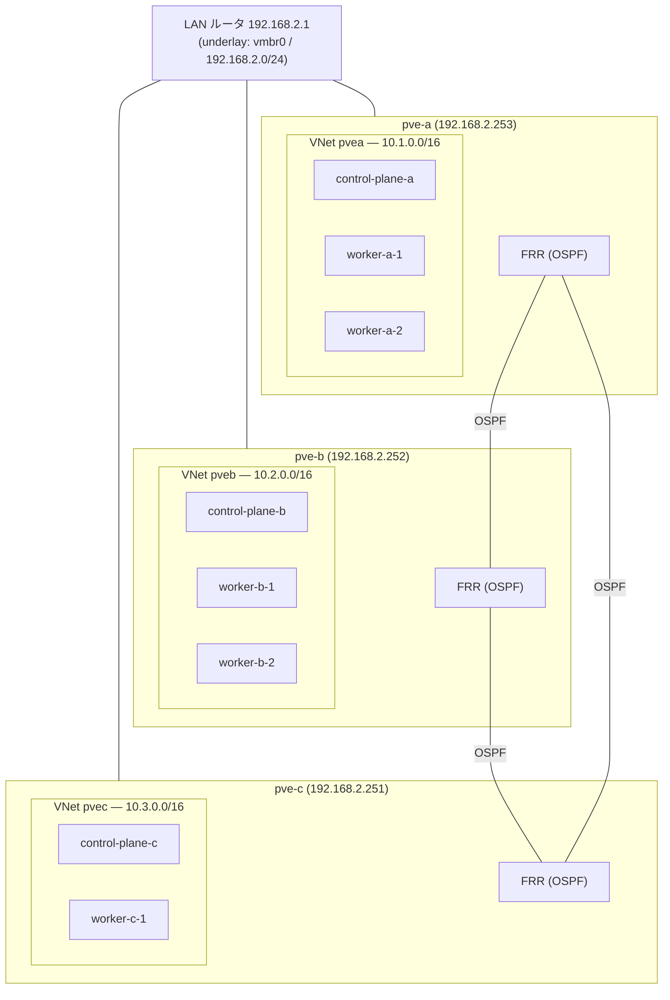
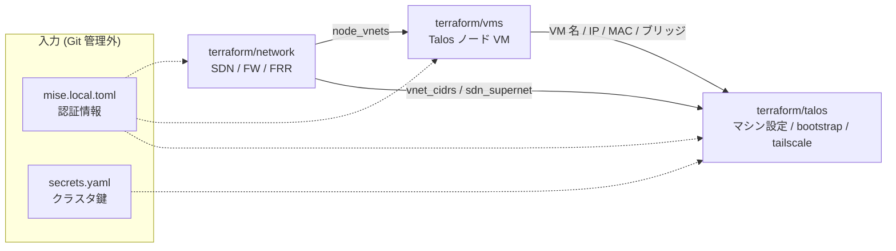

# Kube on Proxmox

Proxmox VE 上に Talos Linux の Kubernetes クラスタを構築・運用する IaC。

## 構成

Terraform のルートモジュール 3 つを依存順に適用する。
上流が生成した事実 (IP・MAC・サブネット) は remote state 参照で下流へ流れるため、
環境依存の値を tfvars に転記しない。各ルートの詳細はそれぞれの README を参照。

| ルート | 管理対象 |
|---|---|
| [terraform/network](terraform/network/README.md) | SDN (zone/vnet/subnet/DHCP)、クラスタファイアウォール、PVE ホストの FRR/OSPF |
| [terraform/vms](terraform/vms/README.md) | Talos ノード VM (bpg/proxmox) |
| [terraform/talos](terraform/talos/README.md) | マシン設定・ブートストラップ・tailscale |

秘密情報は `terraform.tfstate` に一切残らない。ファイル管理は `secrets.yaml` (Git 管理外) のみで、
その他は `mise.local.toml` (Git 管理外) から mise が環境変数として読み込む。

## アーキテクチャ

### ネットワーク

各 PVE ホストにノードローカルな SDN Simple ゾーンがあり、ホスト間は FRR の OSPF が
`10.0.0.0/8` 配下の経路を underlay (vmbr0) 越しに交換する。
各 VM は vmbr0 (LAN ルータの DHCP) と自ホストの VNet (SDN の dnsmasq による DHCP) の
2 つの NIC を持ち、kubelet / etcd / Pod ネットワークは VNet 側を使う。
全ノードは tailscale にも参加し、各自の VNet サブネットを広告する。



### Terraform のデータフロー

設計値は各ルートの tfvars にのみ書き、インフラが生成した事実 (IP・MAC・サブネット) は
remote state 参照で下流へ流す。



## セットアップ

開発ツールは [mise](https://mise.jdx.dev/) で管理する。

```sh
mise install
```

新しい PVE ホストではストレージのコンテンツ種別を一度だけ設定する
(パッケージ類は terraform/network が構成する):

```sh
pvesm set local --content images,rootdir,vztmpl,backup,iso,snippets
```

## 適用

認証情報は `mise.local.toml` (Git 管理外) に置くと自動で環境変数として読み込まれる:

```sh
cp mise.local.toml.template mise.local.toml
vim mise.local.toml  # 各値を埋める

mise run apply          # network → vms → talos の順に適用
mise run apply:network  # 個別に適用する場合
```

ノードの IP が DHCP で変わった場合も同じ手順でよい (vms の refresh で新しい IP が
talos まで伝播する)。kubeconfig / talosconfig の取得は
[terraform/talos/README.md](terraform/talos/README.md) を参照。
